<picture>
  <source media="(prefers-reduced-motion: reduce) and (prefers-color-scheme: dark)" srcset="assets/profile/hero-dark-static.svg" />
  <source media="(prefers-reduced-motion: reduce)" srcset="assets/profile/hero-light-static.svg" />
  <source media="(prefers-color-scheme: dark)" srcset="assets/profile/hero-dark.svg" />
  
</picture>

<picture>
  <source media="(prefers-reduced-motion: reduce) and (prefers-color-scheme: dark)" srcset="assets/profile/typing-dark-static.svg" />
  <source media="(prefers-reduced-motion: reduce)" srcset="assets/profile/typing-light-static.svg" />
  <source media="(prefers-color-scheme: dark)" srcset="assets/profile/typing-dark.svg" />
  
</picture>

  
  
  

**Building intelligent software. Understanding the systems behind it.**

## ◈ A little about me

I'm **Thevindu**, a Software Engineering undergraduate at **Informatics Institute of Technology (IIT)**, affiliated with the **University of Westminster**.

I build full-stack applications and explore how **machine learning, LLMs, and retrieval** can make them more useful. My projects range from species identification to a cinnamon business’s storefront and internal tools. I’m also deepening my understanding of backend architecture, AI agents, and reliable software systems.

<picture>
  <source media="(prefers-reduced-motion: reduce) and (prefers-color-scheme: dark)" srcset="assets/profile/divider-dark-static.svg" />
  <source media="(prefers-reduced-motion: reduce)" srcset="assets/profile/divider-light-static.svg" />
  <source media="(prefers-color-scheme: dark)" srcset="assets/profile/divider-dark.svg" />
  
</picture>

## ◈ Tools behind the work

Technologies I use across projects and ongoing learning — not a ranking of expertise.

**AI & machine learning**

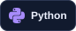 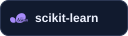 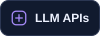 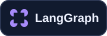  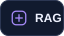

**Frontend**

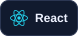 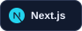 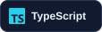  

**Backend**

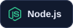 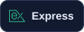 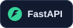 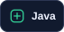 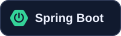

**Database & data**

  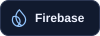 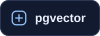

**DevOps & tools**

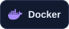 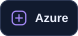  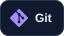 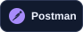

## ◈ Selected work

From learning experiments to applications for real users.

<picture>
  <source media="(prefers-color-scheme: dark)" srcset="assets/profile/project-venomverse-dark.svg" />
  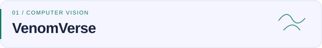
</picture>

**ML-assisted species identification · Team project**

A Flutter app for identifying snakes, insects, and spiders from images, with Python model services and species-specific safety information.

  

[Explore the team repository →](https://github.com/PulinduYK/VenomVerseApp)

<picture>
  <source media="(prefers-color-scheme: dark)" srcset="assets/profile/project-rag-dark.svg" />
  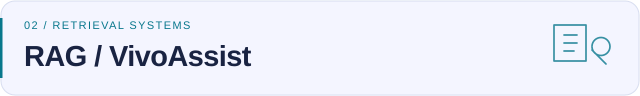
</picture>

**Embeddings, vector search & the software around them**

My RAG Chatbot work explores retrieval with React, pgvector, and Azure. **VivoAssist is a separate public implementation**: a Python CLI that retrieves content from PDF manuals using LlamaIndex, ChromaDB, and Azure OpenAI, with page references in its responses.

  

[Explore VivoAssist →](https://github.com/gurugetnm/vivoassist-rag-system)

<picture>
  <source media="(prefers-color-scheme: dark)" srcset="assets/profile/project-cinnamon-dark.svg" />
  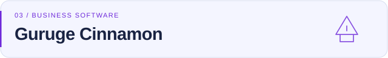
</picture>

**Ceylon cinnamon · Storefront & business operations**

A multilingual storefront for product discovery, direct ordering, and export enquiries, alongside a separate internal production tracker for daily output and worker production.

  

[Visit the storefront →](https://gurugecinnamon.site)

<picture>
  <source media="(prefers-color-scheme: dark)" srcset="assets/profile/project-reliability-dark.svg" />
  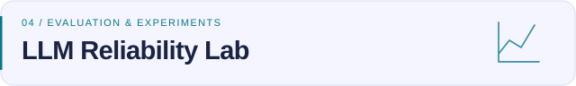
</picture>

**Model behaviour · Reproducible experiments · Evaluation**

A local platform for comparing model and prompt outputs, running dataset-based evaluations, and inspecting regressions. Experiment and evaluation workflows are implemented; its RAG engine remains on the roadmap.

   

[Explore the repository →](https://github.com/gurugetnm/llm-reliability-lab)

<picture>
  <source media="(prefers-color-scheme: dark)" srcset="assets/profile/project-network-dark.svg" />
  
</picture>

**Learning ML through network-traffic analysis**

An educational project using UNSW-NB15 for data exploration, preprocessing, and a logistic regression baseline. It is preparation for further research, rather than a validated encrypted-C2 detection system.

 

[Explore the repository →](https://github.com/gurugetnm/network-ml-lab)

## ◈ What I’m exploring

<picture>
  <source media="(prefers-reduced-motion: reduce) and (prefers-color-scheme: dark)" srcset="assets/profile/focus-dark-static.svg" />
  <source media="(prefers-reduced-motion: reduce)" srcset="assets/profile/focus-light-static.svg" />
  <source media="(prefers-color-scheme: dark)" srcset="assets/profile/focus-dark.svg" />
  
</picture>

Applied ML research, reliable LLM and RAG systems, backend architecture, and full-stack applications that solve practical problems.

<picture>
  <source media="(prefers-reduced-motion: reduce) and (prefers-color-scheme: dark)" srcset="assets/profile/divider-dark-static.svg" />
  <source media="(prefers-reduced-motion: reduce)" srcset="assets/profile/divider-light-static.svg" />
  <source media="(prefers-color-scheme: dark)" srcset="assets/profile/divider-dark.svg" />
  
</picture>

## ◈ The work, in motion

<picture>
  <source media="(prefers-color-scheme: dark)" srcset="assets/profile/stats-dark.svg" />
  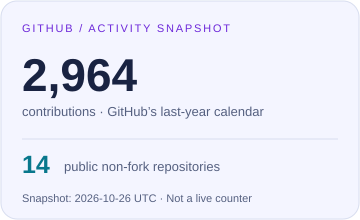
</picture>
<picture>
  <source media="(prefers-color-scheme: dark)" srcset="assets/profile/languages-dark.svg" />
  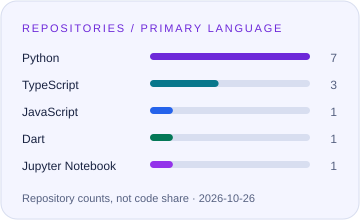
</picture>

Timestamped snapshots from GitHub. Language bars count repositories by their primary language; forks are excluded. These are not live counters.

### A year of contributions

<picture>
  <source media="(prefers-reduced-motion: reduce) and (prefers-color-scheme: dark)" srcset="assets/profile/calendar-dark.svg" />
  <source media="(prefers-reduced-motion: reduce)" srcset="assets/profile/calendar-light.svg" />
  <source media="(prefers-color-scheme: dark)" srcset="assets/profile/snake-dark.svg" />
  
</picture>

[Live activity](https://github.com/gurugetnm?tab=overview) · [All repositories](https://github.com/gurugetnm?tab=repositories) · [How these visuals stay updated](assets/README.md)

<picture>
  <source media="(prefers-color-scheme: dark)" srcset="assets/profile/footer-dark.svg" />
  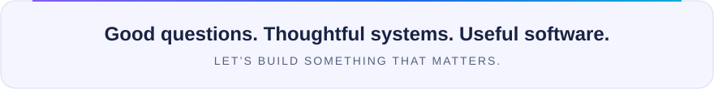
</picture>

Have an idea worth exploring? [Let’s talk](mailto:gurugetnm@gmail.com).

